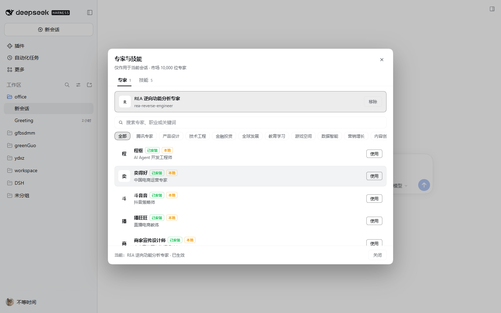
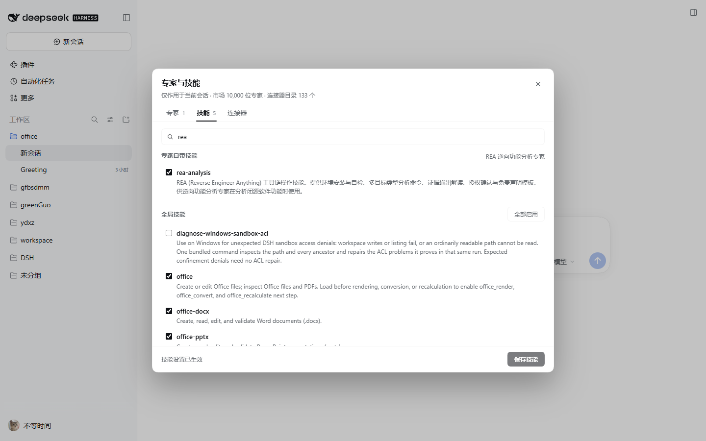
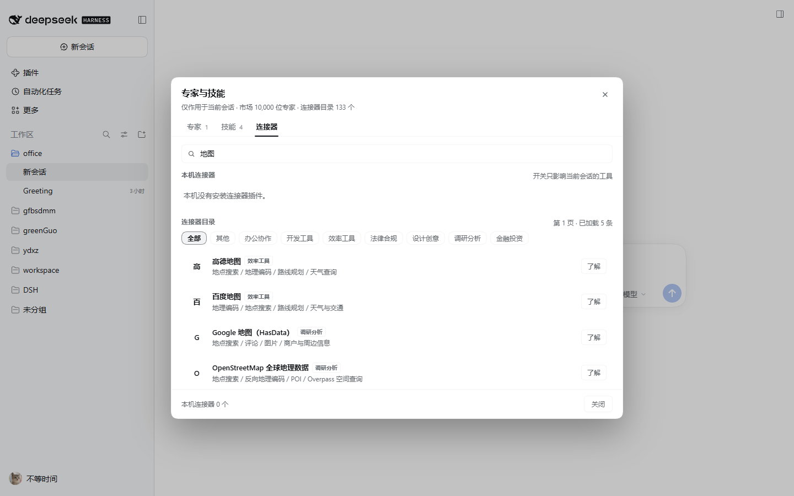
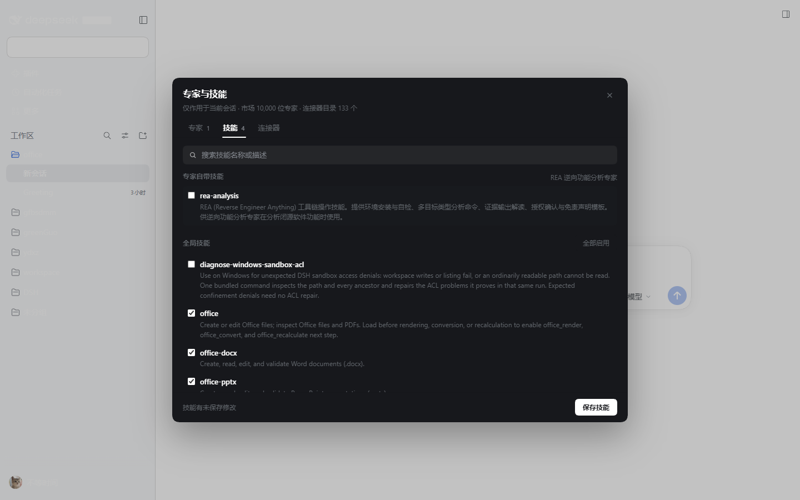
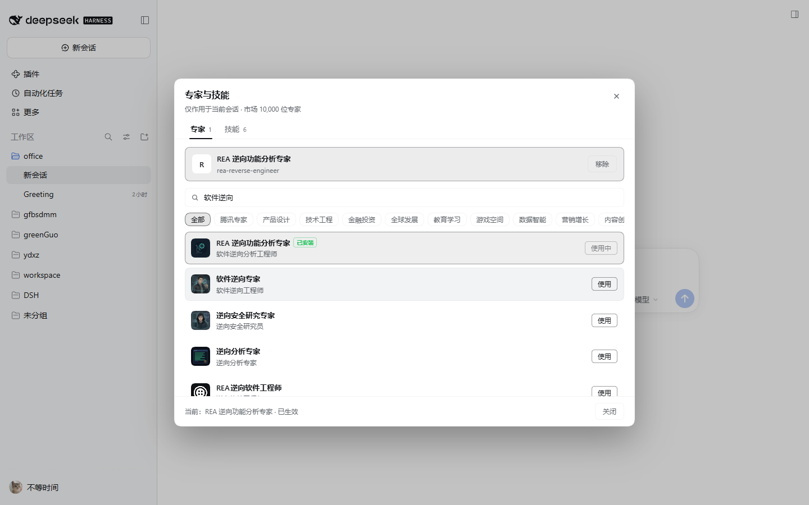
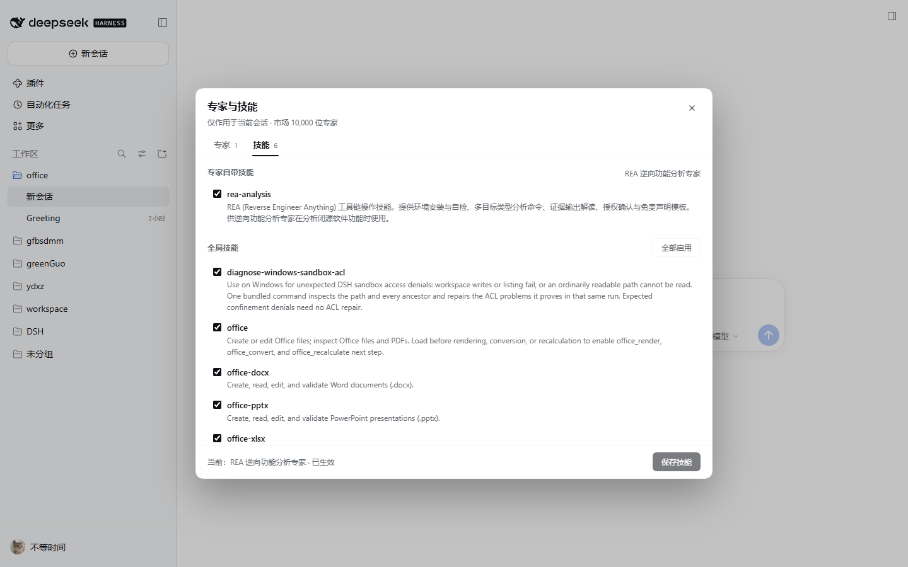
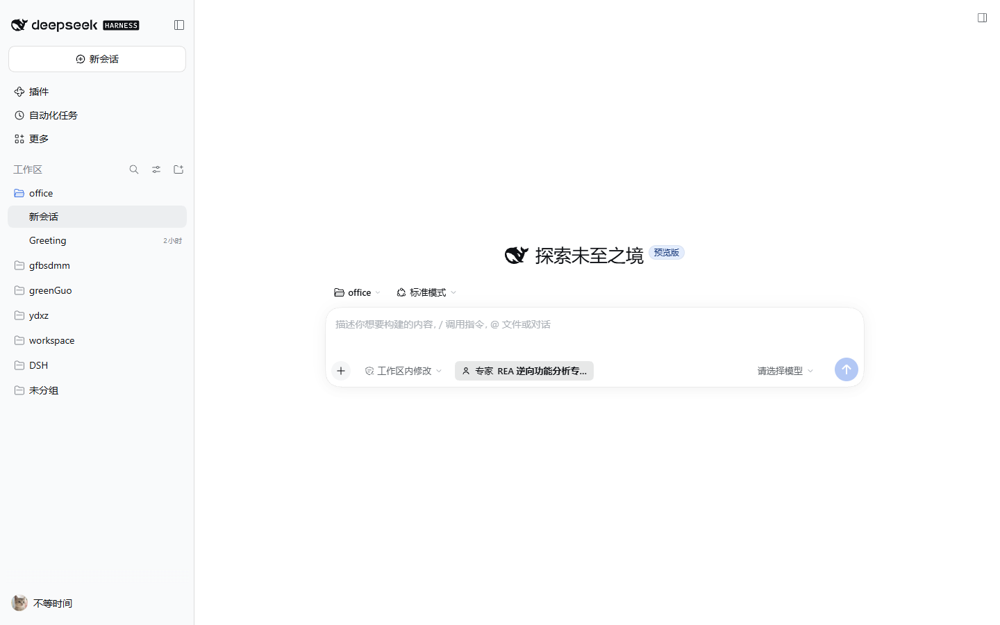

# dsh-workbuddy-helper

DeepSeek Harness 插件：在当前会话内选择、切换、移除专家与技能，并把 WorkBuddy connector 的账号状态接入插件。

- 专家来源：WorkBuddy 在线市场（需要账号）+ 公开快照（离线兜底）+ 本机已安装专家
- 技能：专家自带技能 + 当前全局技能，按会话启用/停用
- 隔离：每个会话通过 `agent.ctx` 独立挂载，销毁即回滚；不写全局配置、不改技能文件
- 身份：默认 `auto`，优先复用 `dsh-connect-workbuddy` 的账号池访问在线市场；没有账号时退回公开快照
- 界面：输入框左侧「专家」按钮 + 可视化面板（专家 / 技能 / 连接器三个页签，支持搜索与开关）

## 输入区面板

安装并重启后，对话输入框左侧会出现「专家」按钮；选中专家后按钮直接显示专家名。
点击打开面板，三个页签：

**专家**：搜索在线市场（10,000 位）与本机已安装专家；按 16 个分类筛选；一键切换或移除。



**技能**：专家自带技能 + 全局技能，顶部搜索框按名称/描述过滤（与 dsh 记忆系统技能管理一致的交互）。



**连接器**：本机连接器插件（如 dsh-windows-mcp、dsh-ima、dsh-connect-*）逐个开关，开关只影响当前会话的工具（通过 `tools.restrict({ deny })` 实现）；下方是 MCP 连接器目录（133 个），支持按名称/厂商/标签搜索与分类筛选。



深色模式适配：主按钮使用「前景/背景」单色反色方案，不再依赖会翻转的品牌色令牌。








选中后回到对话，输入区按钮会显示当前专家：



面板由同源的 `/dsh-workbuddy-helper/*` JSON 路由驱动，不启动额外端口，也不把 token 暴露给浏览器。

## 两个市场入口（重要）

WorkBuddy 有两条完全不同的数据源，条数差异很大：

| 入口 | 地址 | 规模 | 是否需要登录 |
|---|---|---|---|
| 在线市场（App 实际使用） | `POST https://www.workbuddy.cn/portal/operation-platform/market/expert/list` | `total_count = 10000`，16 个分类 | 需要账号 token |
| 公开快照（CDN 静态清单） | `https://acc-1258344699.cos.accelerate.myqcloud.com/workbuddy/expert-marketplace/expert_center.json` | 429 个专家，15 个分类，`lastUpdated=2026-08-18` | 匿名可读 |

在线市场才是 App 里看到的列表。公开快照只是周期性发布的子集：本机已安装的
`rea-reverse-engineer`（REA 逆向功能分析专家 / 软件逆向分析工程师）和
`senior-fullstack-engineer`（高级全栈工程师）都能在线市场按 ID 查到，但都不在 429 条快照里。

插件默认 `marketMode: auto`：先查在线市场，失败或没有账号时退回快照，并在结果里返回
`source: portal|cos` 与 `warning`，不会再把快照条数当成市场总量。

## 安装

### 标准安装（npm）

插件发布到 npm 后，其他人使用：

```bash
dsh plugin --profile <profile> add dsh-workbuddy-helper
```

当前环境没有 npm 发布凭据，尚未执行 `npm publish`；仓库已补齐 `files`、`publishConfig` 与打包验证。维护者发布：

```bash
npm login
npm publish
```

发布后即可用上面的一行命令安装，不依赖 GitHub、SSH key 或 Git。

### 离线 tarball 安装（当前可用）

```bash
npm pack
dsh plugin --profile <profile> add /absolute/path/to/dsh-workbuddy-helper-0.2.7.tgz
```

也可以把 tarball 放到任意 HTTPS 静态地址，再用 URL 安装：

```bash
dsh plugin --profile <profile> add https://your-cdn.example.com/dsh-workbuddy-helper-0.2.7.tgz
```

### 从 GitHub 安装（仅开发调试）

```bash
dsh plugin --profile <profile> add git+ssh://git@github.com/awswt/dsh-workbuddy-helper.git
```

这条命令可用，但不建议给最终用户：需要本机配置 GitHub SSH、Git 和 pnpm 的 Git 构建链，版本也不如 npm semver 直观。它适合开发者拉最新源码，不是标准分发方式。

### 本机开发安装

```bash
dsh plugin --profile <profile> add /absolute/path/to/dsh-workbuddy-helper
```

安装后重启对应 profile。插件会写入 profile 的 `dsh.profile.bundles`，不需要手动改 `cordis.patch.yml`。

## 使用

### 模型工具

工具名：`workbuddy_helper`

| action | 作用 |
|---|---|
| `status` | 当前会话的专家、技能、应用状态、connector 与认证状态 |
| `expert` | 选择专家，参数 `expertId` 可填专家 id、plugin slug 或 agentName |
| `off` | 移除当前会话的专家，恢复全部全局技能 |
| `skills` | 列出全局技能与专家技能，以及当前启用状态 |
| `set-skills` | 调整技能开关：`mode=all\|selected`、`names=a,b`、`expertNames=c,d` |
| `connector` | WorkBuddy connector 检测结果、账号数量、可用账号数（不含 token） |
| `market` | 搜索在线市场 + 本机已安装专家；结果带 `source=portal\|cos\|local`、`installed`、`marketTotal`，参数 `query` |
| `categories` | 在线市场的 16 个分类（快照兜底时为快照分类） |

示例：

```text
workbuddy_helper(action="connector")
workbuddy_helper(action="market", query="软件逆向分析工程师")
workbuddy_helper(action="market", query="逆向")
workbuddy_helper(action="expert", expertId="ex_QvM298ih8T8g")
workbuddy_helper(action="expert", expertId="rea-reverse-engineer")
workbuddy_helper(action="skills")
workbuddy_helper(action="off")
```

### 斜杠命令

```text
/workbuddy-helper status
/workbuddy-helper market 内容
/workbuddy-helper expert ai-agent-engineer
/workbuddy-helper skills
/workbuddy-helper off
/workbuddy-helper connector
```

命令与工具都只作用于“发起调用的会话”，不需要 sessionId 参数，也不会影响其他会话。

## 配置

```yaml
- insert:
    - id: workbuddy-helper
      name: dsh-workbuddy-helper
      config:
        enabled: true
        marketMode: auto
        authMode: auto
        portalBaseUrl: https://www.workbuddy.cn
        portalPrefix: /portal
        marketBaseUrl: https://acc-1258344699.cos.accelerate.myqcloud.com/workbuddy/expert-marketplace
        manifestPath: /expert_center.json
        timeoutMs: 20000
        retries: 1
        cacheTtlMs: 21600000
        staleWhileErrorMs: 604800000
        maxPromptChars: 60000
        maxSelectedSkills: 64
```

| 字段 | 默认 | 说明 |
|---|---|---|
| `enabled` | `true` | 总开关 |
| `marketMode` | `auto` | `auto`（在线优先，快照兜底） / `portal`（只在线） / `cos`（只快照） |
| `authMode` | `auto` | `auto`（有 connector token 就用）/ `none` / `bearer` / `header` / `cookie` / `workbuddy-connector` |
| `credentialRef` | `WB_EXPERT_TOKEN` | DSH 凭据服务中的键名，仅 `bearer/header/cookie` 使用 |
| `headerName` | `Authorization` | 认证头名 |
| `headerPrefix` | `Bearer ` | 认证头前缀 |
| `connectorRegion` | 自动 | `cn / global`，仅 connector 模式使用 |
| `portalBaseUrl` | `https://www.workbuddy.cn` | 在线市场基址；账号记录里的 `domain` 会覆盖它 |
| `portalPrefix` | `/portal` | 在线市场路由前缀 |
| `marketBaseUrl` | 公开快照基址 | 必须是 HTTPS，且在 `allowHosts` 内 |
| `allowHosts` | 快照 + `www.workbuddy.cn` / `www.workbuddy.ai` / `openplatform-cdn.codebuddy.cn` | 允许接收凭据或下载的 host |
| `allowInsecureLoopback` | `false` | 仅本地测试使用 |
| `allowPublicMarketAuth` | `false` | 允许把 connector token 发到公开快照 host；默认拒绝，防止误配泄露 |
| `maxPromptChars` | `60000` | 专家提示词截断上限 |
| `maxSelectedSkills` | `64` | 单会话技能上限 |
| `dataDir` | `$DSH_HOME/workbuddy-helper` | sidecar 与缓存目录 |
| `localRoots` | 两个 WorkBuddy 目录 | 本地专家来源，只读 |

## WorkBuddy connector 接入

插件只读 `dsh-connect-workbuddy` 的账号库：

```text
$DSH_HOME/workbuddy-vault/<region>/<accountId>.json
```

行为：

- `connector` 动作返回 `installed / profile / version / accountCount / usableAccountCount / accounts`；
- 账号 id 与昵称做掩码，token 永远不出现在 `status()`；
- 不刷新 token、不写 vault、不解密；
- `authMode: auto`（默认）时，在线市场请求使用第一个未过期账号的 `accessToken`，基址取该账号的 `auth.domain`；
- `authMode: workbuddy-connector` 是它的严格版本：没有可用 token 就报错，不会退回快照；
- token 只会发往 `allowHosts` 内的 host，且只发给在线市场 API；签名 CDN 下载 URL 不带 Authorization 头。

企业网关或需要鉴权的市场：

```yaml
authMode: workbuddy-connector
allowHosts:
  - your-enterprise-gateway.example.com
marketBaseUrl: https://your-enterprise-gateway.example.com/workbuddy/expert-marketplace
```

或使用 DSH 凭据服务：

```yaml
authMode: bearer
credentialRef: WB_EXPERT_TOKEN
```

凭据通过 DSH 的 credentials 服务写入，配置里只出现键名。

## 会话隔离

- 选择专家时，插件在 `agent.ctx` 下挂载一个子插件：`systemPrompt.section` + 两个技能 provider。
- `workbuddy-helper-expert-<gen>`（rank 200）提供专家自带技能。
- `workbuddy-helper-filter-<gen>`（rank 1000）影子化全局技能，未选中的设为不可调用。
- 新 fiber 挂载成功后才销毁旧 fiber；失败时旧人格保留。
- 状态写入 `$DSH_HOME/workbuddy-helper/sessions/<sha256(sessionId)>.json`，`agent/created` 时恢复。
- 子代理与 fork 默认不继承；它们有独立的 Agent/Session。

## 安全

- 专家包是数据，不是代码：只读 markdown/资源，不执行脚本，不 `npm install`。
- 解包拒绝绝对路径、`..`、符号链接/硬链接，限制条目数与解压体积；在线市场的 ZIP 与快照的 tar.gz 都走同一套白名单。
- 专家提示词以 `<expert_selection>` 包裹，转义闭合标签，并声明不得覆盖安全规则、工具权限与危险操作确认。
- 凭据只发往 allow-list 的 HTTPS host；重定向逐跳校验；错误与日志不包含 token。
- 市场内容仍可能包含提示注入，权限系统与用户确认仍是最后防线，不承诺 100% 免疫。

## 数据与缓存

```text
$DSH_HOME/workbuddy-helper/
├─ cache/
│  ├─ manifest.json
│  ├─ manifest.meta.json
│  ├─ bundles/
│  └─ downloads/
└─ sessions/
   └─ <sha256(sessionId)>.json
```

清理缓存不会影响会话选择；下次使用会重新下载。

## 开发与测试

```bash
npm install
npm test
```

当前测试覆盖：提示词转义、HTTPS/host 允许列表、内联密钥拒绝、WorkBuddy connector 只读解析、在线市场接口与 Bearer 头、在线优先/快照兜底、ZIP 与 tar 解包、路径穿越、本机专家解析、输入区面板的同源路由与跨源拒绝。

UI 冒烟（需要 Playwright + 本机 Edge）：

```bash
dsh --profile <web-profile> --no-open --port 3131
node .workbuddy/tmp/ui-smoke3.mjs  # 三页签：专家/技能(搜索)/连接器
# 可选：装一个真实连接器验证开关
# dsh plugin --profile <web-profile> add dsh-windows-mcp
```

### 手工端到端测试（假模型）

`test/fake-model-e2e.mjs` 与 `test/fake-model-expert-e2e.mjs` 会启动一个本地 Messages 兼容 SSE 服务，冒充模型返回 `workbuddy_helper` 工具调用，用来验证真实 DSH 宿主里的工具执行、专家提示段与技能目录注入。需要先安装到测试 profile，并设置：

```bash
DSH_APP_EXE="D:/Program Files/deepseek harness/DeepSeek Harness.exe" DSH_BIN="D:/Program Files/deepseek harness/resources/app.asar/dsh/node_modules/@deepseek-ai/dsh/lib/bin.js" DSH_TEST_PROFILE=workbuddy-helper-gh node test/fake-model-expert-e2e.mjs
```

脚本不会访问真实模型，也不会消耗 token；假 token 只发给本地 127.0.0.1 服务。

设计文档：[docs/dsh-workbuddy-helper-design.md](docs/dsh-workbuddy-helper-design.md)

安装与测试报告：[docs/INSTALLATION-AND-TEST-REPORT.md](docs/INSTALLATION-AND-TEST-REPORT.md)

## License

MIT
