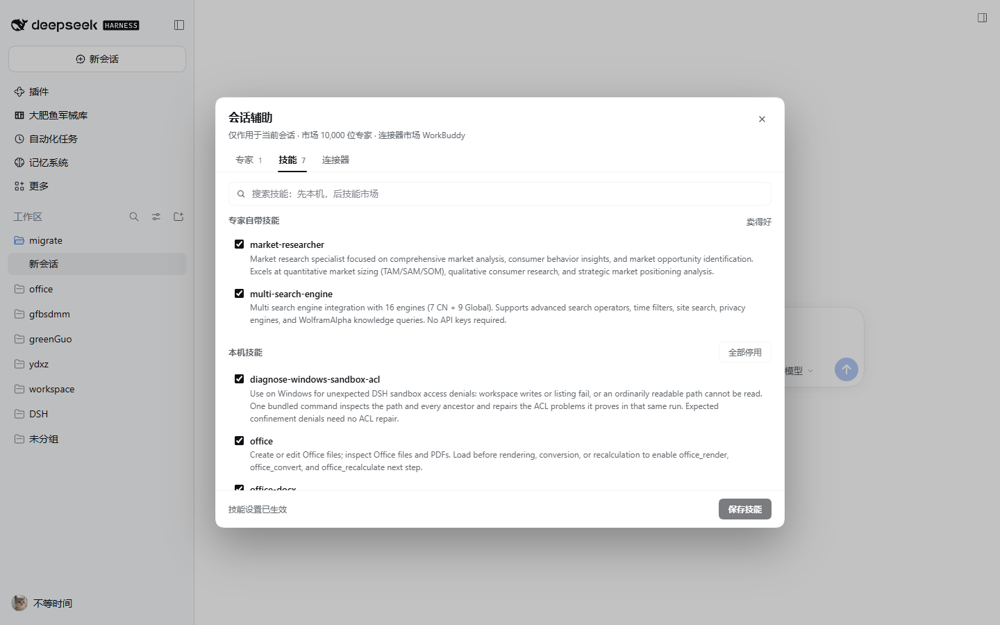
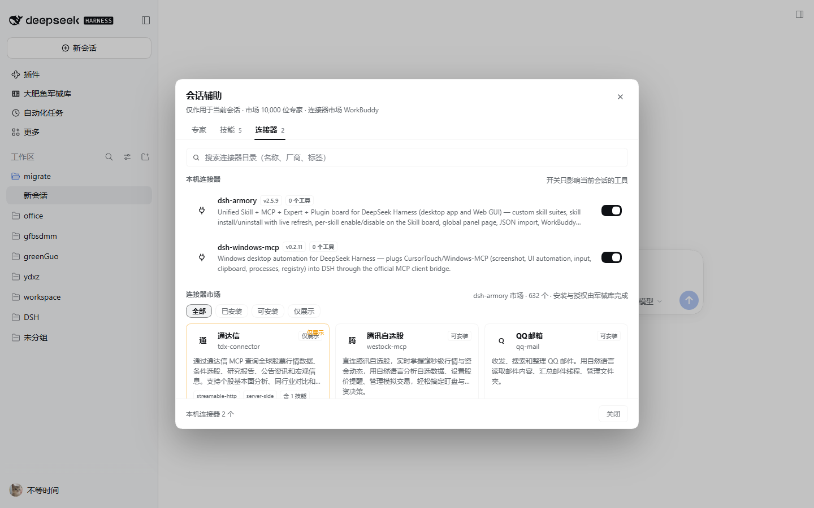

# dsh-workbuddy-helper

DeepSeek Harness 插件：在当前会话里挑选**专家**、管理**技能**、连接**连接器**（MCP 工具），三个市场都来自 WorkBuddy。

- **专家**：从 WorkBuddy 专家市场（10,000 位）或本机已装专家里挑一个，注入当前会话的 system prompt，并把专家自带技能并入技能目录。
- **技能**：从 WorkBuddy 技能市场（3,400+ 条）**直接安装**到当前工作区的 `.dsh/skills/<技能名>/`，下一轮会话即可启用；也能按会话开关本机技能。
- **连接器**：从连接器目录（134 条）连接 MCP 服务，工具以 `mcp__<server>__*` 进入当前会话；能按会话启用/停用，不影响别的会话。

所有选择都是**会话级**的：插件不写全局配置、不替别的会话做决定。唯一会落到 profile 的产物是连接器需要的 `cordis.patch.yml`（MCP server 声明）。

## 安装

需要 DSH 桌面版（44.x 起）与 Node `22.19+` 或 `24+`。

不需要预装 `dsh-connect-workbuddy`，也不需要 WorkBuddy 桌面端——本插件自己完成 WorkBuddy 登录并自己保存登录态。

### 从 npm 安装

```bash
dsh plugin --profile <profile> add dsh-workbuddy-helper
```

### 从 tarball 安装

```bash
npm pack
dsh plugin --profile <profile> add /absolute/path/to/dsh-workbuddy-helper-<version>.tgz
```

也可以把 tarball 放到任意 HTTPS 静态地址，再用 URL 安装：

```bash
dsh plugin --profile <profile> add https://your-cdn.example.com/dsh-workbuddy-helper-<version>.tgz
```

### 从 GitHub 安装

```bash
dsh plugin --profile <profile> add git+https://github.com/awswt/dsh-workbuddy-helper.git
```

需要本机有 Git 与 pnpm 的 Git 构建链；版本不如 npm semver 直观。

安装后**完全重启 DSH**（不是只关闭会话）。插件会自己写进 profile 的 `dsh.profile.bundles`，不需要手动改 `cordis.patch.yml`。

> 为什么必须重启而不是重载：插件在激活时才注册 `webServer` 路由。旧进程里残留的旧路由会让面板出现 `cannot get required service "agents" in inactive context`、专家切换无响应、面板 404 之类的现象。

## 面板

对话输入框左侧是「会话辅助」按钮（选中专家后按钮上显示当前专家名）。点开是四个页签：

**专家**：搜索 WorkBuddy 专家市场（10,000 位）与本机已装专家，按分类筛选，一键切换或移除。

**技能**：上方搜索本机已装技能，下方是 WorkBuddy 技能市场。市场里的技能可以直接**安装到当前工作区**——点「安装」会下载技能包并解到 `<工作区>/.dsh/skills/<技能名>/`，装好的行按钮变成「重新安装」。装完不影响正在跑的会话，下一轮就能在「本机技能」里看到并开关。



技能市场有两个来源，页签按本机情况显示：

- **WorkBuddy 技能市场**：始终可用，需要登录 WorkBuddy（见「WorkBuddy 账号接入」）。
- **记忆系统技能市场**：只有当前 profile 装了 `dsh-mnemon` 才出现。它不是本插件的能力，只是把你送到 dsh-mnemon 自己的技能管理页（技能 / 进化 / 评测 / 市场 / 回收站）。没装那个包时这个页签不会渲染——它指向一个不存在的页面，留着只会误导。

**连接器**：两部分。上半区是本机已装的连接器插件，开关只影响当前会话的工具可见性；下半区是连接器目录（134 条），支持按名称/描述搜索，需要凭据的会在行内直接收 API Key 或 Bearer Token。

连接器有三种落地形态，面板会分别标注：

| 形态 | 徽标 | 说明 |
|---|---|---|
| 目录连接器 | — | 点「连接」后把 server 写进 `cordis.patch.yml`，**重启 DSH 后**工具才挂载，期间显示「待重启生效」 |
| 插件连接器 | — | 工具已由宿主注册，开关只是把当前会话的工具视图放开或收紧 |
| 连接器管理页建立 | 连接器管理页 | 连接与 OAuth 授权都在 `dsh-mcp-connector` 的 `/mcp-connector/ui` 完成。本插件只读这份状态，按钮是「在管理页打开」，不提供会和对方打架的「断开」 |



若本机装了 **dsh-armory**，连接器页会额外复用它的 `remote.mcpManager` 服务：卡片网格、详情、安装与 OAuth 授权弹层由军械库提供，凭据也由它保存。没装时用本插件自带的目录与连接流程，两者都能把工具接进当前会话。

**账号**：本插件自己的 WorkBuddy 登录（见「WorkBuddy 账号接入」）。选国内版/国际版 → 开始登录 → 扫码 → 我已完成；下半部分只读列出 `dsh-connect-workbuddy` 的旧账号，可一键导入。

> 截图可能落后于当前界面（面板迭代较快），以实际界面为准；更多历史截图在 `docs/ui-*.png`。

面板由同源的 `/dsh-workbuddy-helper/*` JSON 路由驱动，不额外开端口，也不会把 token 交给浏览器。

## 模型工具

工具名：`workbuddy_helper`，只作用于发起调用的会话。

| action | 作用 |
|---|---|
| `status` | 当前会话的专家、技能、连接器与登录态 |
| `expert` | 选择专家，`expertId` 可填专家 id、plugin slug 或 agentName |
| `off` | 移除当前会话的专家，恢复全部全局技能 |
| `skills` | 列出全局技能与专家技能及启用状态；`skillAction=installed` 列出工作区已装技能；`skillAction=install` 配合 `skillId` 直接安装市场技能（`force=true` 可强制解除残留安装锁） |
| `set-skills` | 调整技能开关：`mode=all\|selected`、`names=a,b`、`expertNames=c,d` |
| `skill-market` | 搜索 WorkBuddy 技能市场，参数 `query`、`page`、`pageSize`（默认 12，上限 24） |
| `connector` | 连接器子动作：`list`（默认，目录 + 插件 + 已连接概览）、`state`、`connect`、`repair`、`cancel`、`disconnect`、`unbind`、`enable`、`disable`，配合 `connectorId`；`connect` 需要凭据时用 `token` |
| `account` | WorkBuddy 登录态：`accountAction=list`（默认）、`login`（配合 `region=cn\|global`，返回扫码链接）、`poll`（配合 `loginId`）、`cancel`、`refresh`（配合 `accountId`）、`remove`、`import`（把旧 `dsh-connect-workbuddy` vault 搬过来） |
| `market` | 搜索在线专家市场 + 本机已装专家，结果带 `source=portal\|cos\|local`、`installed`、`marketTotal`，参数 `query` |
| `categories` | 在线市场的 16 个分类（快照兜底时为快照分类） |

示例：

```text
workbuddy_helper(action="status")
workbuddy_helper(action="expert", expertId="ai-agent-engineer")
workbuddy_helper(action="off")
workbuddy_helper(action="skill-market", query="word", pageSize=12)
workbuddy_helper(action="skills", skillAction="install", skillId="skill_2095395851789164544")
workbuddy_helper(action="skills", skillAction="installed")
workbuddy_helper(action="connector", connectorAction="connect", connectorId="amap", token="...")
workbuddy_helper(action="account", accountAction="login", region="cn")
workbuddy_helper(action="account", accountAction="poll", loginId="wbh_...")
workbuddy_helper(action="market", query="软件逆向分析工程师")
```

## 斜杠命令

```text
/workbuddy-helper status
/workbuddy-helper expert ai-agent-engineer
/workbuddy-helper off
/workbuddy-helper skills
/workbuddy-helper skills install skill_2095395851789164544
/workbuddy-helper skills installed
/workbuddy-helper skills install skill_2095395851789164544 --force
/workbuddy-helper connector list
/workbuddy-helper connector connect amap
/workbuddy-helper connector state amap
/workbuddy-helper account login region=cn
/workbuddy-helper account poll loginId=wbh_...
/workbuddy-helper account import
/workbuddy-helper market 内容
```

命令与工具都只作用于发起调用的会话，不需要 sessionId 参数，也不会影响其他会话。

## 配置

```yaml
- insert:
    - id: workbuddy-helper
      name: dsh-workbuddy-helper
      config:
        enabled: true
        marketMode: auto
        authMode: auto
        portalBaseUrl: https://www.workbuddy.cn
        portalPrefix: /portal
        marketBaseUrl: https://acc-1258344699.cos.accelerate.myqcloud.com/workbuddy/expert-marketplace
        manifestPath: /expert_center.json
        timeoutMs: 20000
        retries: 1
        cacheTtlMs: 21600000
        staleWhileErrorMs: 604800000
        maxPromptChars: 60000
        maxSelectedSkills: 64
```

| 字段 | 默认 | 说明 |
|---|---|---|
| `enabled` | `true` | 总开关 |
| `marketMode` | `auto` | `auto`（在线优先，快照兜底） / `portal`（只在线） / `cos`（只快照） |
| `authMode` | `auto` | `auto`（有 connector token 就用）/ `none` / `bearer` / `header` / `cookie` / `workbuddy-connector` |
| `credentialRef` | `WB_EXPERT_TOKEN` | DSH 凭据服务中的键名，仅 `bearer/header/cookie` 使用 |
| `headerName` | `Authorization` | 认证头名 |
| `headerPrefix` | `Bearer ` | 认证头前缀 |
| `connectorRegion` | 自动 | `cn / global`，仅 connector 模式使用 |
| `portalBaseUrl` | `https://www.workbuddy.cn` | 在线市场基址；账号记录里的 `domain` 会覆盖它 |
| `portalPrefix` | `/portal` | 在线市场路由前缀 |
| `marketBaseUrl` | 公开快照基址 | 必须是 HTTPS，且在 `allowHosts` 内 |
| `allowHosts` | 快照 host + `www.workbuddy.cn` / `www.workbuddy.ai` / `openplatform-cdn.codebuddy.cn` | 允许接收凭据或下载的 host |
| `allowInsecureLoopback` | `false` | 仅本地测试使用 |
| `allowPublicMarketAuth` | `false` | 允许把 connector token 发到公开快照 host；默认拒绝，防止误配泄露 |
| `maxPromptChars` | `60000` | 专家提示词截断上限 |
| `maxSelectedSkills` | `64` | 单会话技能上限 |
| `dataDir` | `$DSH_HOME/workbuddy-helper` | sidecar、缓存与账号库目录 |
| `accountsDir` | `$DSH_HOME/workbuddy-helper/accounts` | 本插件自己的账号库 |
| `legacyVaultDir` | `$DSH_HOME/workbuddy-vault` | 旧插件 `dsh-connect-workbuddy` 的 vault，只读；设为空串即完全不读 |
| `localRoots` | 两个 `~/.workbuddy` 目录 | 本地专家来源，只读；目录不存在就等于没有本机专家 |

## 两个专家市场入口（重要）

WorkBuddy 有两条完全不同的数据源，条数差异很大：

| 入口 | 地址 | 规模 | 是否需要登录 |
|---|---|---|---|
| 在线市场（App 实际使用） | `POST https://www.workbuddy.cn/portal/operation-platform/market/expert/list` | `total_count = 10000`，16 个分类 | 需要账号 token |
| 公开快照（CDN 静态清单） | `https://acc-1258344699.cos.accelerate.myqcloud.com/workbuddy/expert-marketplace/expert_center.json` | 429 个专家，15 个分类 | 匿名可读 |

在线市场才是 App 里看到的列表；公开快照只是周期性发布的子集。插件默认 `marketMode: auto`：先查在线市场，失败或没有账号时退回快照，并在结果里返回 `source: portal|cos` 与 `warning`，不会再把快照条数当成市场总量。

## WorkBuddy 账号接入

**本插件自己完成登录**，不需要装 `dsh-connect-workbuddy`，也不需要 WorkBuddy 桌面端。

打开面板的**账号**页签：

1. 选站点——`国内版`（`www.codebuddy.cn`）或 `国际版`（`www.workbuddy.ai`）。这两个是独立的账号体系，一个域名签发的 token 会被另一个域名的网关拒绝，所以要选你真正在用的那个。
2. 点「开始登录」，浏览器会打开一个扫码页。
3. 扫码完成后回到面板点「我已完成」。

登录成功后 token 存进本插件自己的账号库：

```text
$DSH_HOME/workbuddy-helper/accounts/<region>/<accountId>.json
```

目录 `0700`、文件 `0600`；面板与工具里显示的都是脱敏视图，`accessToken` 永远不会出现在 `status()`、日志或错误信息里。
access token 快过期时自动用 refresh token 换新的，换不动了才让你重新登录。

### 从 dsh-connect-workbuddy 迁过来

如果你以前装过那个插件、已经登录过，它的 vault 会被**只读**地列在账号页下半部分，点「全部导入本插件」即可搬过来，之后可以卸载它：

```text
$DSH_HOME/workbuddy-vault/<region>/<accountId>.json   # 只读，本插件永不写入
```

也可以纯命令行：

```text
workbuddy-helper account login region=cn
workbuddy-helper account poll loginId=<id>
workbuddy-helper account import
```

`authMode: auto`（默认）的来源顺序是「本插件账号库 → 旧 vault」，用哪个会在 `status` 的 `source` 里写清楚
（`helper-accounts` / `dsh-connect-workbuddy` / `snapshot-only`）。
`authMode: workbuddy-connector` 是严格版：没有可用 token 就报错，不退回公开快照。

token 只会发往 `allowHosts` 内的 host，且只发给市场 API；签名 CDN 下载 URL 不带 Authorization 头。

### 不装 WorkBuddy 桌面端会有影响吗

没有。桌面端和本插件没有任何文件或进程关系——全仓库在 `lib/` 下搜 `WorkBuddy.exe` / `asar` 零命中。

唯一沾边的是「本机已装专家」这一栏，它读：

```text
~/.workbuddy/plugins/marketplaces/experts/plugins
~/.workbuddy/plugins/marketplaces/my-experts
```

目录不存在就当作"本机没有额外专家"，不是错误。专家市场（10,000 位）、技能安装、连接器目录全部走 https，照常可用。

企业网关或需要鉴权的市场：

```yaml
authMode: workbuddy-connector
allowHosts:
  - your-enterprise-gateway.example.com
marketBaseUrl: https://your-enterprise-gateway.example.com/workbuddy/expert-marketplace
```

或使用 DSH 凭据服务：

```yaml
authMode: bearer
credentialRef: WB_EXPERT_TOKEN
```

凭据通过 DSH 的 credentials 服务写入，配置里只出现键名。

## 技能装到哪里

技能会装到**当前工作区**的 `.dsh/skills/<技能名>/`。这里的"当前工作区"指 DSH 认定的项目根：从会话工作目录向上找到的第一个含 `.git` 的目录。装到别处会出现"装成功但不显示"。

技能目录是热加载的，装完不用重启；**改动插件自身代码才需要重启 DSH**。

同一个技能并发安装会被串行化（进程内队列 + `<skillsRoot>/.lock-<技能名>` 目录锁）。如果上一次安装的进程异常退出留下了锁，面板会给出「强制重试」，命令行可以 `--force` 越过它——注意这会打断真正在跑的另一个安装。

## 会话隔离

- 选择专家时，插件在 `agent.ctx` 下挂载一个子插件：`systemPrompt.section` + 两个技能 provider。
- `workbuddy-helper-expert-<gen>`（rank 200）提供专家自带技能。
- `workbuddy-helper-filter-<gen>`（rank 1000）影子化全局技能，未选中的设为不可调用。
- 连接器开关走每 agent 的 `tools.restrict({ deny })`，只影响该 agent 的工具视图。
- 新 fiber 挂载成功后才销毁旧 fiber；失败时旧人格保留。
- 状态写入 `$DSH_HOME/workbuddy-helper/sessions/<sha256(sessionId)>.json`，`agent/created` 时恢复。
- 子代理与 fork 默认不继承；它们有独立的 Agent/Session。

## 安全

- 专家包是数据，不是代码：只读 markdown/资源，不执行脚本，不 `npm install`。
- 解包拒绝绝对路径、`..`、符号链接/硬链接，限制条目数与解压体积。
- 技能包是 UGC：`SKILL.md` 会进入模型上下文，包内 `scripts/*` 可能被执行。下载 URL 必须过 host 白名单，市场提供了 `fingerprint` 时强校验 sha256。
- 专家提示词以 `<expert_selection>` 包裹，转义闭合标签，并声明不得覆盖安全规则、工具权限与危险操作确认。
- 凭据只发往 allow-list 的 HTTPS host；重定向逐跳校验；错误与日志不包含 token。
- 不替 `dsh-mcp-connector` 写它的存储：那份表有跨进程日志与锁，两边同时写会丢 token。要断开/解绑请在管理页操作。
- 市场内容是 UGC，仍可能包含提示注入；权限系统与用户确认仍是最后防线，不承诺 100% 免疫。

## 数据与缓存

```text
$DSH_HOME/workbuddy-helper/
├─ accounts/<region>/<accountId>.json   # 登录态（目录 0700、文件 0600，含 token）
├─ connectors.json          # 连接器绑定状态、会话开关、管理页跳转埋点
├─ cache/
│  ├─ manifest.json
│  ├─ manifest.meta.json
│  ├─ bundles/
│  └─ downloads/
└─ sessions/
   └─ <sha256(sessionId)>.json
```

清理缓存不会影响会话选择；下次使用会重新下载。`accounts/` 与 `connectors.json` 都含凭据，别提交进版本库、别共享出去。

工作区里另有两处：

```text
<projectRoot>/.dsh/skills/<技能名>/   # 装进来的技能
<profileDir>/cordis.patch.yml         # 连接器写入的 MCP server 声明
```

## 常见问题

**面板打不开 / 提示 `cannot get required service "agents" in inactive context`**
完全重启 DSH。插件路由在激活时注册，热重载清不掉旧进程里的路由。

**连接器点「连接」后显示「待重启生效」**
目录连接器要写进 `cordis.patch.yml`，只有 DSH 启动时才读。重启后工具的徽标会变成「已连接」并显示工具数。

**连接器显示「需授权」**
这条连接器用 OAuth。点「去授权」会打开 `dsh-mcp-connector` 的管理页完成授权，回来后状态会自动同步。

**技能装成功但「本机技能」里没有**
检查是不是装到了项目根之外。技能加载器只扫 `<projectRoot>/.dsh/skills`。

**技能市场显示「未检测到 WorkBuddy 登录态」**
打开面板的**账号**页签登录一次即可。本插件自己登录、自己存 token，不需要装 `dsh-connect-workbuddy`。
以前装过那个插件的话，也可以直接在同一个页签点「全部导入本插件」。

**专家市场只有 429 条**
那是公开快照，没有登录态时的兜底。登录 WorkBuddy 就能拿到 10,000 条在线市场。

**技能页看不到「记忆系统技能市场」**
这个页签只在当前 profile 装了 `dsh-mnemon` 时出现。装了就重启 DSH；没装就没这个入口——它本来就是 dsh-mnemon 自己的技能管理页，本插件只负责把你送过去。

## 相关文档

- [自己登录 WorkBuddy（三个端点实测与分层凭据）](docs/workbuddy-own-login.md)
- [逆向分析：WorkBuddy 连接器管理](docs/workbuddy-connector-reverse-engineering.md)
- [连接器模块改造与验证报告](docs/connector-upgrade-test-report.md)
- [端到端基线（可复跑的 11 项检查）](docs/e2e-baseline.md)
- [设计与实现](docs/dsh-workbuddy-helper-design.md)
- [安装与测试报告](docs/INSTALLATION-AND-TEST-REPORT.md)

## License

MIT
